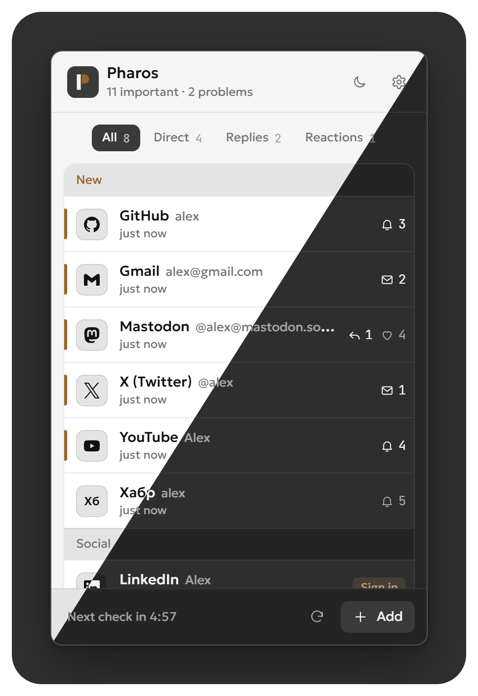
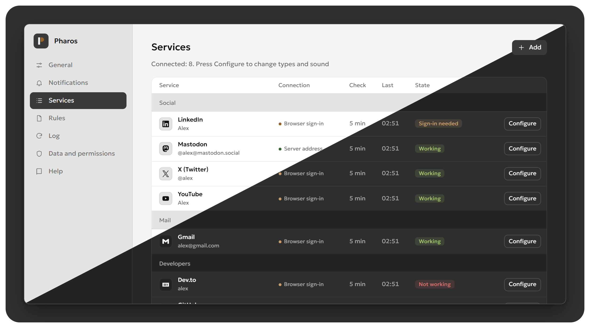
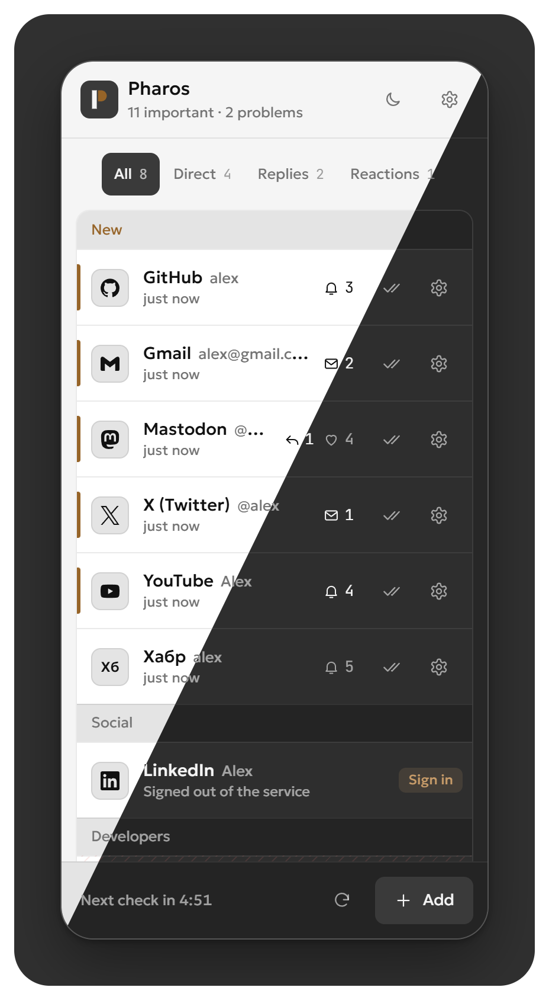
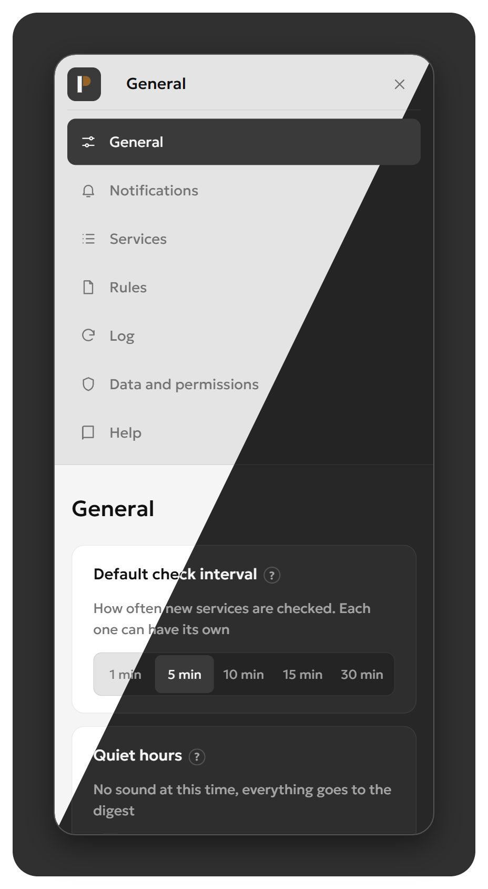
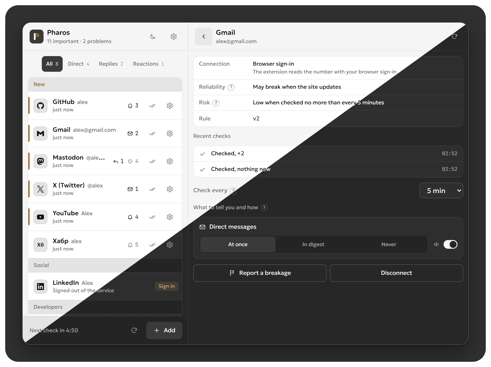

<h1>
  
  Pharos
</h1>

[](./LICENSE)
[](https://github.com/m-o-z-z-i-x/Pharos/releases)


Browser extension for Chrome and Firefox that checks your accounts every few minutes and tells you where notifications arrived — with all service tabs closed

<a href="https://addons.mozilla.org/en-US/firefox/addon/pharos/">
  <picture>
    <source srcset="https://i.imgur.com/ZluoP7T.png">
    
  </picture>
</a>
<br>
<br>

> [!IMPORTANT]
>
> **Privacy First:** the extension has no server and collects no statistics. Requests go only to the services you connected, plus one update check a day against the public repository to refresh the rule catalog (nothing of yours is sent). From every answer the extension takes only numbers (and a sender name where a service gives it); message texts, feeds and contacts are never stored, shown or sent anywhere. Details are in [PRIVACY.md](./PRIVACY.md)

> [!NOTE]
>
> Supported now: Mastodon, Bluesky, Matrix (official APIs), Gmail, X (Twitter), LinkedIn, Instagram, Threads, Reddit, Pinterest, Medium, Dev.to, daily.dev, GitHub, GitLab, YouTube, Yandex Mail, Habr, Twitch, Notion and Facebook (through your browser sign-in)

## 🖥️ Screenshots

**Computer** — the popup and the settings page (Chrome and Firefox)

<p align="center">
  
</p>

**Phone** — the popup and the settings menu (Firefox for Android)

<p align="center">
  
</p>

**Tablet** — the list stays on the left, a service opens on the right

<p align="center">
  
</p>

---

## 📦 Install

- **Firefox** - Install it from [Firefox Add-ons](https://addons.mozilla.org/en-US/firefox/addon/pharos/): it works in Firefox 128 and newer, on a computer and on Android, and updates by itself. The same signed `.xpi` file is attached to every [release](https://github.com/m-o-z-z-i-x/Pharos/releases/latest): open it in Firefox and confirm the installation
- **Chrome** - The Chrome Web Store comes later. Until then take `Pharos-…-Chrome.zip` from the [latest release](https://github.com/m-o-z-z-i-x/Pharos/releases/latest), unpack it, open `chrome://extensions`, turn on «Developer mode», press «Load unpacked» and pick the unpacked folder. Chrome does not update such an extension by itself: for a newer version repeat these steps

> [!TIP]
>
> Both browsers can also load a build made from the source, see «Building from source» in the Develop section below. Chrome: «Load unpacked» and pick `.output/chrome-mv3`. Firefox: open `about:debugging#/runtime/this-firefox`, press «Load Temporary Add-on» and pick `manifest.json` in `.output/firefox-mv3`; Firefox removes a temporary add-on when it closes, so for everyday use take the store version or the signed `.xpi`

---

## 🚀 Key Features

- **🔔 Types of notifications** - Direct messages, replies, reactions, followers and the rest are counted separately. The numbers in a row are the ones the site shows
- **🎚️ Modes per service and type** - Now (with sound), digest (once an hour by default) or off
- **🌙 Quiet mode** - A manual switch and quiet hours; while it is on, everything waits for the digest
- **🛠️ Honest about breakage** - If a service stops being checked, the row is marked and the reason is written next to it
- **🔒 Private by design** - No server, no statistics, no message texts stored or shown

---

## 🛠️ Using

- **Add a service** - Press «Add» in the popup, pick a service and follow the steps right there. Where the browser asks for access to the site, allow it: the extension asks for one site at a time
- **Check now** - The refresh button in the popup or the `R` key
- **Quiet mode** - The moon button in the popup or the `Q` key
- **Mark as read** - The double check in a row. The numbers stay as on the site, only what arrived after that is counted as new
- **Open the popup** - `Alt+Shift+S`

The browser icon shows a number when something important is new: the types set to «Now», which are direct messages and replies by default. When nothing important is new but some service could not be checked, it shows a red «!». In quiet mode the icon stays empty

> [!TIP]
>
> Services with an official API (Mastodon, Bluesky, Matrix) are the most stable. The rest (Gmail, X and so on) are checked through your browser sign-in by a signed rule from `rules/catalog.json`, so they can break when a site changes its pages. A fix then arrives with a catalog update, without a new version of the extension

### 🔑 Permissions

| Permission | Why |
|---|---|
| Access to a site (asked per service) | read the notification count on this site |
| `storage` | keep the service list and settings in the browser |
| `alarms` | wake up for the nearest job: a check, the digest or the end of quiet hours |
| `notifications` | show notifications |
| `cookies`, `declarativeNetRequestWithHostAccess` | if the browser did not attach your sign-in to a request, add it — only for granted sites |
| `identity` | sign in through your server page (Mastodon, Matrix); Firefox for Android does not have it |
| `offscreen` (Chrome) | play sound and parse HTML outside tabs |

Access to a site can be taken back at any time in the settings, «Data and permissions»

---

## 🔨 Develop

### 🔧 Requirements

- Node.js 20+
- Chrome 116+ or Firefox 128+

### ⚡️ Quick Setup Guide

- **Clone & Open Project**
  ```bash
  git clone https://github.com/m-o-z-z-i-x/Pharos.git pharos
  cd pharos
  code .
  ```
- **Install Dependencies**
  ```bash
  npm install
  ```
- **Run**
  ```bash
  npm run dev # Chrome
  npm run dev:firefox # Firefox
  ```
  The build lands in `.output/chrome-mv3-dev` (or the Firefox one): load it as an unpacked extension. A change in the background code needs a reload of the extension, the interface updates by itself
- **Build**
  ```bash
  npm run build && npm run build:firefox
  npm run zip && npm run zip:firefox
  ```

### 🏗️ Building from source

The store packages are built from this source with nothing else involved, and the result is byte for byte the same on every build

- **Environment** - Any OS, Node.js 20 or newer with npm (the packages were verified with Node.js 24 and npm 11)
- **Install** - Exactly the versions of the lockfile
  ```bash
  npm ci
  ```
- **Build** - The unpacked extension lands in `.output/chrome-mv3` or `.output/firefox-mv3`
  ```bash
  npm run build           # Chrome
  npm run build:firefox   # Firefox
  ```
- **Pack** - The ready archive for the store lands in `.output` next to the archive of this source
  ```bash
  npm run zip             # Chrome
  npm run zip:firefox     # Firefox
  ```

The build only bundles and minifies the files in `src`. No code is generated or downloaded during it, and the signed rule catalog `rules/catalog.json` is plain data

### 📜 Rules for services

A rule is a description, not code: extension stores forbid loading code from a server. Rules live in `rules/catalog.json`. This is the real rule of Gmail:

```jsonc
{
  "id": "gmail",
  "version": 2,
  "name": "Gmail",
  "mono": "Gm", // two letters for the logo
  "group": "mail",
  "hosts": ["mail.google.com"], // the only sites the rule may touch
  "multi": true, // several accounts of the service are allowed

  "account": {
    "field": "n", // which mailbox of the browser: the number in the address
    "default": "0",
    "addUrl": "https://accounts.google.com/AddSession?continue=https%3A%2F%2Fmail.google.com%2Fmail%2F"
  },

  "auth": {
    "kind": "cookie", // the browser's own sign-in is used
    "loginUrl": "https://accounts.google.com/ServiceLogin?service=mail&continue=https://mail.google.com/mail/u/{n}/"
  },

  "openUrl": "https://mail.google.com/mail/u/{n}/#inbox",

  "requests": [
    { "key": "inbox", "url": "https://mail.google.com/mail/u/{n}/feed/atom", "parse": "text" }
  ],

  "label": { // how the account is named in the list
    "from": "inbox",
    "regex": "<title>[^<]*?([\\w.+-]+@[\\w.-]+)[^<]*</title>"
  },

  "map": { // which number goes to which type of notification
    "dm": { "from": "inbox", "xml": "fullcount" }
  }
}
```

**Types** are `dm`, `reply`, `react`, `follow` and `other`. **Ways to get a number** from an answer:

| Key | What it does |
|---|---|
| `json` | a path (`a.b[0].c`), a filter (`items[tab=MESSAGING].count`) or a list of paths that add up |
| `regex` | the first group of a regular expression over the text |
| `xml` | the content of a tag |
| `unreadChats` | unread chats in a Meta mailbox (Instagram), counted the way the site makes its badge |
| `isNot` | turns a dot-only indicator into 1 or 0: it is 1 while the value differs from the quiet one |
| `zero` | a missing counter means 0 |

**What a request can do:**

| Key | What it does |
|---|---|
| `GET` or `POST` with `form` or `json` | the request itself |
| `{ "cookie": "ct0" }` | take a header or form value from a cookie; `strip` and `template` cut or wrap it |
| `{ "from": "home", "regex": "…" }` | take a value from an earlier answer; `template` puts it inside a longer value |
| `{ "uuid": true }` | a made-up device id |
| `{ "sapisidhash": origin }` | sign the request the way Google pages do |
| `origin` | send it as if from the site's own page |
| `reuse` (minutes) | keep the tokens of a heavy page, load it again when the site refuses them |
| `acceptStatus` | read the error code of a guest instead of failing |

**How a rule tells that something is wrong:**

| Key | What it does |
|---|---|
| `loggedOutIf.missing` | a sign that you are signed out |
| `loggedOutIf.redirectTo` | a redirect to the login page means a lost sign-in |
| `loggedOutIf.equals` | a guest flag in the answer |
| `loggedOutIf.bodyIncludes` | a text in the page; it also turns off the loading of only what the counters need |
| `onMissing: "login"` | next to a token taken from a page: a page that gives the token only to a signed-in visitor, so its absence means a lost sign-in (Threads) |
| `errorIf` | an error the site reports inside a normal answer, so it is never read as zero notifications |
| `defaults` | the modes of the types that suit the service by default |

A check loads only what the counters need: the account name is read once, when connecting. The catalog is signed with Ed25519 (`node scripts/sign-rules.mjs` after any change), and the extension rejects an update without a valid signature

---

## 🌟 Future Roadmap

**Done**
- [x] **Firefox Add-ons** - The extension passed the review and is published in the store
- [x] **More services** - X (Twitter), LinkedIn, Instagram, Threads, Reddit, Pinterest, Medium, Dev.to, daily.dev, GitHub, GitLab, YouTube, Yandex Mail, Habr, Twitch, Notion, Facebook
- [x] **Direct messages on Instagram** - Counted from the list of chats the way the site makes its badge

**Planned improvements**
- [ ] **Even more services** - VK, Mail.ru, Outlook.com, Stack Overflow: their counters look reachable through the browser sign-in; the catalog shows them as in the works
- [ ] **Direct messages on Threads** - The same mailbox, to be checked on an account with chats
- [ ] **Direct messages on Facebook** - Messenger chats are end-to-end encrypted in the browser, so only notifications are counted for now
- [ ] **Discord** - Its count needs a key to the whole account, which is unsafe to keep; the extension explains this in the catalog
- [ ] **Telegram** - Its counters need a sign-in whose session key opens the whole account, which is unsafe to keep; the extension explains this in the catalog
- [ ] **Own services** - Custom rules for plain-HTML sites

*Suggestions?* [Open an Issue](https://github.com/m-o-z-z-i-x/Pharos/issues/new) to discuss new features!

---

## 🤝 Contribution

Contributions are welcome! Here's how to help improve the project

- **Fork the repository**
- **Create a feature branch**
  ```bash
  git checkout -b feature/your-feature-name
  ```
- **Commit your changes** — `[TYPE]: short description`, where `TYPE` is `FEAT`, `FIX`, `CHORE`, `REFACTOR`, `DOCS` or `STYLE`
  ```bash
  git commit -m "[FEAT]: your feature description"
  ```
- **Push to your fork**
  ```bash
  git push origin feature/your-feature-name
  ```
- **Open a Pull Request** to the main branch of this repository

---

## 🔗 Acknowledgments

This project would not be possible without these open-source projects

- **[WXT](https://wxt.dev)** — the build of the extension for Chrome and Firefox
- **[@noble/ed25519](https://github.com/paulmillr/noble-ed25519)** by Paul Miller — the signature of the rule catalog

---

## 📈 Repo Activity


---

## 🙏 Support

> ⭐ **Love this project? Give it a star!**

If you find this extension helpful and want to support its development — consider buying me a coffee!

<p align="left">
  <a href="https://yoomoney.ru/to/4100118628464111" target="_blank">
    
  </a>
  <a href="https://boosty.to/m-o-z-z-i-x/donate" target="_blank">
    
  </a>
  <br><br>
  <b>BTC:</b>
  <blockquote>bc1qunr4lkes5xdanln8j5l0gm6e7x0kfw2e6z4yve</blockquote>

  <b>TON:</b>
  <blockquote>UQBZVRZFeZI4CepVq_OF5_KiQ_oo62SzmWlGvppfGuyRqUSE</blockquote>

  <b>XMR:</b>
  <blockquote>89vPf9GUBdFXmpEhFiBSiQMQbAeWZYCGDZBfr6e45zpNVUQ8cMnYFc8ct5FH3TJvftSbKTgkHzkiPB9QoYKhNhBdLeWvesC</blockquote>

  <b>USDT (TRC20):</b>
  <blockquote>TCKL4YBLAFEHFesUuGBiB85aywNE38zVSQ</blockquote>
</p>

---

## 📬 Contacts

All my contact links are available [here](https://github.com/m-o-z-z-i-x/m-o-z-z-i-x?tab=readme-ov-file#-contacts)

---

## 📝 License

This project is licensed under the [MIT License](./LICENSE)